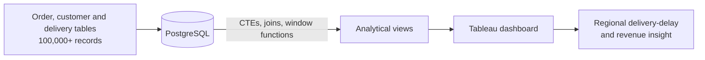

# E-Commerce Sales & Logistics Dashboard

Interactive Tableau dashboard backed by advanced PostgreSQL queries over 100,000+ order records, built to find where deliveries are slowing down by region.

**Stack:** PostgreSQL · SQL (CTEs, joins, window functions) · Tableau

## The problem
Sales were growing, but delivery delays were not visible in one place. The business question: **which regions have logistics bottlenecks, and how do they relate to revenue?**

## Architecture



## Approach
- **SQL layer:** CTEs and window functions compute delivery times, rankings and regional aggregates directly in PostgreSQL, so Tableau stays thin and fast.
- **Dashboard:** geospatial revenue trends are mapped against delivery delays so the worst regions stand out.

## Results
- Regional logistics bottlenecks identified across 100,000+ records.
- One interactive view that links revenue and delivery performance.

## Run it
```bash
git clone https://github.com/VasilenData/ecommerce-logistics-dashboard.git
cd ecommerce-logistics-dashboard
createdb ecommerce
psql ecommerce -f sql/schema.sql      # tables
psql ecommerce -f sql/views.sql       # analytical views used by the dashboard
```
Then open the Tableau workbook and point it at the `ecommerce` database.

## Status
SQL and workbook are being added to this repository.

---
Built by [Vasilen Kanchev](https://vasilendata.github.io) · [LinkedIn](https://www.linkedin.com/in/vasilenkanchev/)
