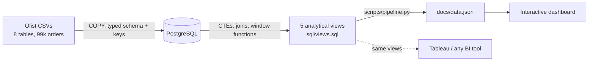

# E-Commerce Sales & Logistics Dashboard

[](https://github.com/VasilenData/ecommerce-logistics-dashboard/actions/workflows/ci.yml) [](LICENSE) 

SQL analysis of 99,441 orders and 112,650 order items from the public Olist marketplace dataset, loaded into **PostgreSQL**, modelled with analytical views (CTEs, joins, window functions) and published as an interactive dashboard.

**Live dashboard: https://vasilendata.github.io/ecommerce-logistics-dashboard/**

**Stack:** PostgreSQL · SQL · Python (loading) · Chart.js dashboard

## The problem
Which regions have logistics bottlenecks, and do they matter commercially?

## Architecture



## What the data says (real output from the views)
- **Late delivery is the review killer.** Orders delivered 7+ days late average a **1.73** review score, versus **4.32** for orders arriving 7+ days early. Orders just 1-7 days late already drop to 3.18.
- **São Paulo carries the business and delivers well:** 38.3% of revenue, 8.8 days average, 5.9% late.
- **Rio de Janeiro is the biggest bottleneck by revenue:** 13.3% of revenue (second largest) but 15.3 days average and **13.5% late**, more than double São Paulo. Fixing RJ matters more than any remote state.
- **The slowest states are small:** Roraima (29.4 days), Amapá (27.2) and Amazonas (26.4) average the longest waits but are each 0.2% of revenue or less. Alagoas stands out at 23.9% late.
- **Health & beauty, watches and bed/bath** are the top three categories by revenue.

## SQL techniques used
`WITH` CTEs · multi-table joins (up to 5 tables) · `LAG`, `RANK`, running `SUM() OVER`, moving average frames · `PERCENTILE_CONT` · `DATE_TRUNC` · conditional bucketing · foreign keys and indexes in the schema

## Tests
`pytest -q` loads a tiny hand-made dataset (four delivered orders, one canceled, two states) into an embedded PostgreSQL and checks the views against values worked out by hand: cancelled orders are excluded, each delivery bucket gets the right review score, state late rate, revenue share and average days match, monthly growth is empty for the first month, and category names come from the English translation. CI runs the same tests and a lint check on every push.

## Run it
```bash
git clone https://github.com/VasilenData/ecommerce-logistics-dashboard.git
cd ecommerce-logistics-dashboard
pip install -r requirements.txt
./scripts/download_data.sh                    # public Olist CSVs into data/
python scripts/pipeline.py                    # uses an embedded local PostgreSQL, nothing to install
# or against your own database:
python scripts/pipeline.py --dsn postgresql://user:pw@localhost/ecommerce
python -m http.server -d docs                 # open http://localhost:8000
```
The views in `sql/views.sql` can also be connected directly to Tableau, Power BI or Metabase.

## Notes and limits
- Data is from 2016-2018; delivery is measured against Olist's own estimated delivery date.
- Revenue is item price in BRL for delivered orders (freight excluded unless stated).
- Dataset license: CC BY-NC-SA 4.0 (Olist).

---
Built by [Vasilen Kanchev](https://vasilendata.github.io) · [LinkedIn](https://www.linkedin.com/in/vasilenkanchev/)
